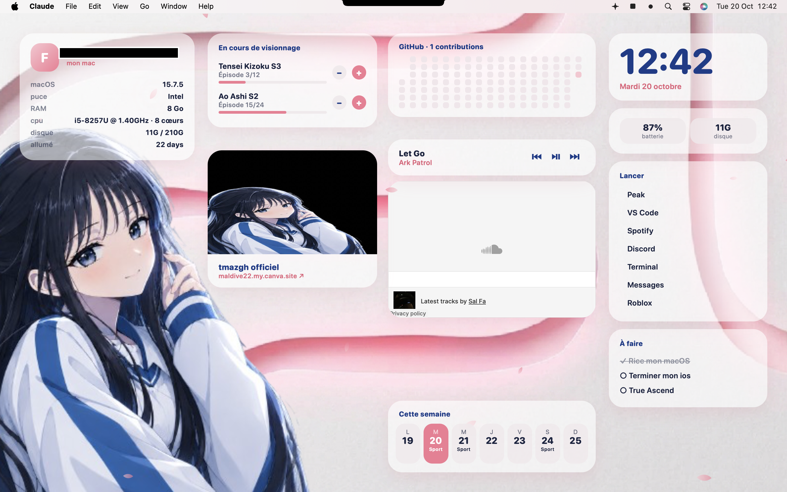

<h1 align="center">Sakura Desk 🌸</h1>

Un bureau macOS en rose clair, bleu et gris argenté, fait de widgets <a href="https://tracesof.net/uebersicht/">Übersicht</a>. A soft pink, blue and silver macOS desktop built with Übersicht widgets.

[🇫🇷 Français](#-français) · [🇬🇧 English](#-english)

---

## 🇫🇷 Français

### Les widgets

| Fichier | Contenu |
|---|---|
| `sakura-desk.jsx` | Horloge, batterie/disque, lanceur d'apps, to-do (colonne de droite) |
| `sakura-profile.jsx` | Ton nom + infos système (macOS, RAM, CPU, disque, uptime) |
| `sakura-anime.jsx` | Suivi d'animes avec boutons − / + (sauvegardé automatiquement) |
| `sakura-music.jsx` | Lecteur Spotify / Musique / SoundCloud (lu depuis l'onglet du navigateur) |
| `sakura-github.jsx` | Grille de contributions GitHub |
| `sakura-calendar.jsx` | Semaine en cours avec tes événements |
| `sakura-web.jsx` | Carte cliquable vers ton site |
| `sakura-petals.jsx` | Pétales de cerisier qui tombent doucement |

### Installation

1. Installe Übersicht : `brew install --cask ubersicht` (ou télécharge-le sur [tracesof.net/uebersicht](https://tracesof.net/uebersicht/)).
2. Ouvre l'app. Une icône apparaît dans la barre de menus.
3. Copie les fichiers sakura-*.jsx dans `~/Library/Application Support/Übersicht/widgets/`.
4. **Ajoute les widgets un par un** : si l'un contient une erreur, Übersicht peut planter. Retire le dernier fichier ajouté si ça arrive.

### Personnalisation

Chaque fichier a ses réglages en haut :

- `sakura-desk.jsx` : `TASKS` (to-do) et `APPS` (lanceur, nom exact de l'app)
- `sakura-profile.jsx` : `NAME`
- `sakura-anime.jsx` : `DEFAULTS` (puis change `KEY` pour repartir de ta liste)
- `sakura-music.jsx` : `SOUNDCLOUD` et `SHOW_PROFILE_PLAYER`
- `sakura-github.jsx` : `USER` (ton pseudo GitHub)
- `sakura-calendar.jsx` : `EVENTS` (format `"AAAA-MM-JJ": ["Événement"]`)
- `sakura-web.jsx` : `URL_SITE`, `TITLE`, `IMAGE`

Les positions sont réglées pour un écran d'environ 1440 px de large. Ajuste `top`, `left`, `right` en haut de chaque fichier si ça chevauche.

### Conseils

- Pour cacher les icônes du bureau : `defaults write com.apple.finder CreateDesktop false; killall Finder`.
- Pour fermer Übersicht depuis le Terminal : `pkill -f bersicht` (`killall Übersicht` ne marche pas à cause du « Ü »).
- La musique demande une autorisation macOS (contrôle de Spotify / du navigateur) la première fois.

> Testé sur macOS Sequoia (Intel). Le comportement peut varier sur d'autres versions.

---

## 🇬🇧 English

### Widgets

| File | What it does |
|---|---|
| `sakura-desk.jsx` | Clock, battery/disk, app launcher, to-do (right column) |
| `sakura-profile.jsx` | Your name + system info (macOS, RAM, CPU, disk, uptime) |
| `sakura-anime.jsx` | Anime tracker with − / + buttons (saved automatically) |
| `sakura-music.jsx` | Spotify / Music / SoundCloud now playing (read from the browser tab) |
| `sakura-github.jsx` | GitHub contribution grid |
| `sakura-calendar.jsx` | Current week with your events |
| `sakura-web.jsx` | Clickable card linking to your site |
| `sakura-petals.jsx` | Gently falling cherry blossom petals |

### Install

1. Install Übersicht: `brew install --cask ubersicht` (or download it from [tracesof.net/uebersicht](https://tracesof.net/uebersicht/)).
2. Open the app. A menu bar icon appears.
3. Copy everything in sakura-*.jsx to `~/Library/Application Support/Übersicht/widgets/`.
4. **Add widgets one at a time**: a widget with an error can crash Übersicht. Remove the last file you added if it does.

### Customize

Settings sit at the top of each file (`TASKS`, `APPS`, `NAME`, `DEFAULTS`, `SOUNDCLOUD`, `USER`, `EVENTS`, `URL_SITE`…). Positions are tuned for a ~1440 px wide screen; tweak `top`, `left` and `right` to fit yours.

> Tested on macOS Sequoia (Intel). Behavior may differ on other versions.

---

## Licence / License

Code: [MIT](LICENSE). Logo and artwork in `assets/`: © 2026 Milas, all rights reserved unless stated otherwise.

Inspired by a macOS rice seen on TikTok. Code written from scratch.

**Milas** · [GitHub](https://github.com/imp0sutoikku) · Discord: `imp_sutoikku`

